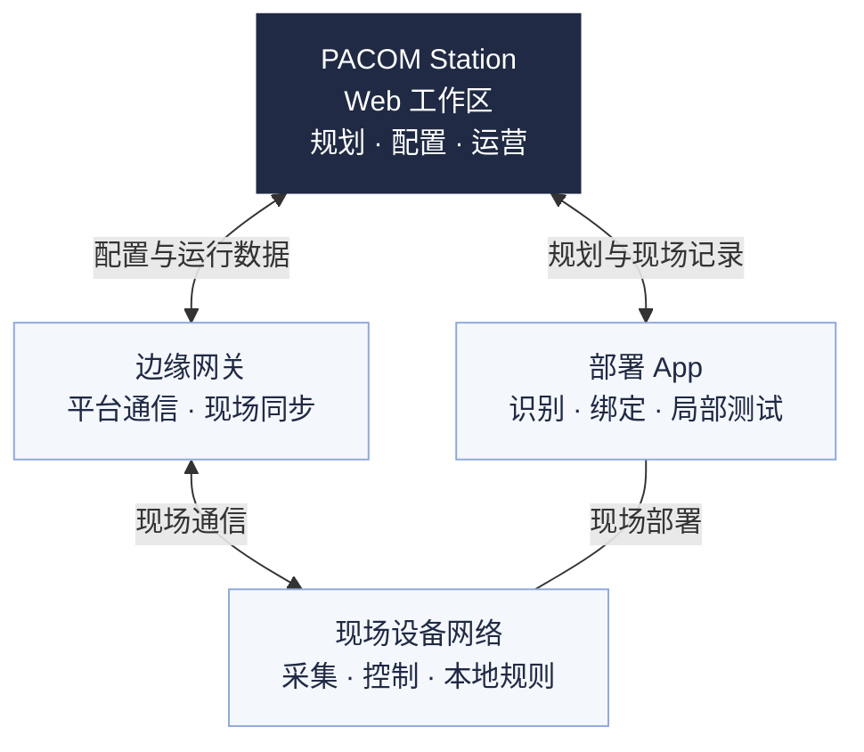

面向业主、设计人员与集成商。先确定建筑要实现的功能，再规划系统、设备和点位，最后复核网络与验收条件，将同一版本的资料交给实施团队。

**设计顺序：明确目标 → 确定架构 → 选型与布点 → 网络设计 → 复核与交接。** 新建项目与既有建筑改造都可按此流程；改造项目先核查现有设备、接线和接口。

## 明确项目目标

把“更智能”“更节能”改成具体场景，写清空间、时间、触发条件、预期动作和需要保留的结果。

| 应用 | 设计需要明确 |
| --- | --- |
| **照明** | 感应开关、调光或恒照度的区域；负载与控制类型、占用和照度来源、回路及手动恢复规则。 |
| **暖通空调** | 风机盘管或多联机的机型与接口；室温来源、有人与无人策略、时间安排、读写范围和原厂保护。 |
| **室内环境** | 所需指标与空间；传感器位置、参考范围、数据质量，以及查看、提示或联动的范围与执行对象。 |
| **能源** | 总量、分项或设备级计量的边界；来源、倍率、单位、统计时间，以及电费和碳排放的计算依据。 |

例如，会议室设计不能只写“有人开灯”：还要说明入口与座位的占用覆盖、控制哪些灯、是否调光、无人延时，以及临时手动操作的退出方式。节能评估另需计量数据和可比较的使用条件。

同时记录建筑用途、工作时间、项目时区、实施阶段、使用人员与维护责任。功能未纳入本次范围时明确排除，不以“预留”代替接口和实施安排。

## 系统架构

PACOM 智能建筑平台采用云端服务。**PACOM Station 是 Web 工作区，部署 App 是独立现场工具**；边缘网关衔接平台与现场设备网络。

这是职责示意，不能作为接线图。首版使用 PACOM 云端服务；第三方空调、表计等按已确认的接入方案连接，不能据图推定所有设备都通过 Mesh 接入。

### 划定系统边界

在系统图上分别标明平台、网关、现场设备、原厂系统和第三方接口，写清每一段由谁提供、配置与维护。

- **本地控制**：同区照明感应、恒照度等按控制器能力与已应用配置执行；开关型负载不能按中间亮度调光。
- **网关与跨系统任务**：列明数据来源、执行对象、控制主体、连接依赖及失败后的处理。跨楼层、跨网络动作单独验证。
- **原厂保护**：空调联锁、防冻等保护仍由设备本地或原厂系统承担，平台不能代替。
- **断联条件**：分别检查平台不可用、网关离线、局部通信中断和重新供电。哪些功能可继续运行，以对应设备、固件、配置与实际测试为准。

### 规划既有系统接入

先取得机型与接口资料、设备清单和数据点表，再确认连接方式。点表至少注明对象对应关系、地址、单位、倍率、数据类型、采集频率与读写范围。

**能读取，不代表能控制。** 多联机内机须对应所属外机，核对原厂限温、设定步长和写入限制；只有电表接入的分体空调按“只计量”规划。联动还需明确唯一控制主体与控制优先级，避免与原厂策略反复覆盖。

协议、驱动、机型或写入能力未验证时，列为待验证事项。平台中出现协议或接入选项，不代表已具备真实驱动与执行服务。详细核对见[系统接入](/platform/integrations#连接与验证)和[开发文档](/developers/index)。

## 设备选型

按“要采集什么、要控制什么、如何接入”选设备。采购前取得所选型号、硬件与固件版本对应的有效规格、接线图和兼容性记录；下表说明用途与必查条件。

| 设备与用途 | 选型时重点核对 |
| --- | --- |
| **多功能传感器** 占用、照度及对应型号支持的环境数据。 | 移动与小幅活动覆盖、安装高度与遮挡、供电来源、占用和照度角色。占用不能当人数。 |
| **空气质量传感器** 室内环境监测。 | 实际测量指标、精度与维护要求、安装位置、供电及 Mesh 或 RS485 接入能力。 |
| **边缘网关** 衔接平台与现场设备网络。 | 联网方式、供电、安装位置、无线适配器、固件与实际网络规模。 |
| **无线适配器** 配合网关接入无线设备网络。 | 与网关的型号、接口、固件兼容及安装条件；与网关作为一个网络方案核对。 |
| **照明控制器** 回路开关或调光控制。 | 开关或 0–10 V 调光、驱动型号与数量、负载功率、启动冲击、传感器供电及散热。 |
| **多联机空调网关** 接入原厂空调系统。 | 品牌与机型、内外机关系、可读可写点、运行模式及原厂控制限制。 |
| **风机盘管温控器** 风机盘管温控与本地操作。 | 两管制或四管制、阀与风机接口、水温传感器、电加热、室温来源及本地保护。 |
| **触控面板** 空间内的查看与操作。 | 可操作对象、供电与通信、控制权限，以及型号与接入方案是否已经确认。 |
| **自发电无线开关** 现场手动操作。 | 接收与适配方式、操作映射、安装位置和覆盖验证；不按普通 Mesh 节点计算。 |

LC20 用于正常照明，消防应急照明不纳入其控制。第一版按单回路开关或 **0–10 V 调光**选型，不默认包含 DALI 或 1–10 V。平台的驱动台数、功率、冲击与传感器数量检查是规划输入，不能代替负载兼容、供电和温升验证。

AQ20 的接入方式必须逐型号确认。当前触控面板接入待确认，自发电开关暂不支持绑定，方案中应保留待验证状态。规划界面允许标记，不代表现场已经支持绑定或接入。

## 空间与点位规划

### 先建立空间，再关联设备

室内按 **项目 → 楼宇 → 楼层 → 功能区**组织；室外道路、广场等建立室外区域，使用总平面图。功能区按实际用途和操作范围划分，例如会议室、办公室、走廊。

同一功能区可包含多类设备。设备的安装位置、服务功能区、供电关系、控制分组和网络归属分别登记，不能由“离它最近”推定。公共区域由运营人员管理，不授予普通成员。

名称在图纸、清单与现场标签中保持一致，例如“办公楼 A · 7F · 会议室 701”。点位名称便于定位，真实设备身份在现场绑定或接入时另行核对。

### 用有效底图确定位置

1. **核对底图与版本**：逐层确认对应楼宇和楼层。平台使用 PDF、PNG、JPEG 或 WebP；DWG、DXF 先转换。
2. **校准比例尺与北向**：用已知距离校准，再核对方向。未校准时不依据图上距离和面积作工程判断；图面面积仍是估算值。
3. **划分功能区**：核对名称、用途、边界和采光面，功能区可共边，不能重叠。
4. **布置点位并复核关系**：记录型号、用途、位置、服务功能区、安装条件及供电或接入关系。每个关键点位都应能在图纸与清单中对应。

### 按应用检查布点

- **照明**：先划分负载与回路，再布传感器。检查入口、座位、小幅活动和遮挡；占用来源、控制照度源与诊断照度分别指定。照度测点应能代表控制区域，不能简单按灯具数量分配传感器。
- **暖通空调**：对应实际风机盘管或多联机内机，明确室温来源和服务空间；登记内外机关系。无人策略与空调自身温控分别说明。
- **室内环境**：明确指标要代表哪个空间，结合产品要求核查气流、热源与位置影响。浓度与指数、当前读数与统计均值分别标明，缺测不当作正常。只有传感器不等于可以自动通风或净化，联动须另配已验证的执行对象。
- **能源**：画清总表与分表的计量边界，记录倍率、单位与负载归属；同一负载不能重复计入总量。计量与按功率、亮度估算的值分别标明。

<AccordionGroup>
  <Accordion title="供电、回路组与控制关系怎样区分" description="把接线事实与控制规则分别落实。">

    **供电关系**按实际接线确认，数据通信按对应型号与固件的接入方式确认。平台中的供电关联不代表数据总线连接；电压、接口和线束以匹配的硬件资料为准。

    **照明回路组**用于同楼层、同设备网络中的共同控制。组内多个 LC20 共用组内占用输入和一个有效控制照度源，其他照度读数用于诊断；额外跟随占用只传占用，限同层同网，不能顺带共用控制照度。

    **自定义分组**用于照明控制、空调控制或仅管理，可跨设备网络，须分别核对成员、容量与同步；不替代供电关系和回路组。场景与联动另按实际执行能力设计与验证。

  </Accordion>
  <Accordion title="标准层怎样复用" description="复用规划，不复制现场身份与验收结论。">

    先核对目标层底图和功能区，再复用设备规划。逐层检查坐标、纵横比、用途、接线、负载、网络与控制关系；只有关系两端都在复制范围内时才考虑沿用。

    网关、代理、中继和系统连接按目标层重新核对。复制不带真实设备身份、网络凭据、绑定回执、功能测试或交付状态；换图或调整功能区后也要复核受影响点位。

  </Accordion>
</AccordionGroup>

平台中的空间、图纸和点位操作见[项目管理](/platform/projects)，应用参数见[应用配置](/platform/application-configuration)，现场交接见[部署调试](/platform/deployment)。

## 网络设计

### 分开设计上行网络与设备网络

| 网络 | 设计需要明确 |
| --- | --- |
| **网关上行网络** | 网关怎样连接 PACOM 云端服务：联网方式、项目网段、地址分配、上网与防火墙条件、IT 负责人及故障排查方式。 |
| **现场设备网络** | 网关与成员怎样通信、App 从哪里接入：网络成员、服务楼层、网关位置、中继和代理、无线连通条件及测试计划。 |

现场设备网络采用 Bluetooth Mesh 的对象按已确认方案入网；RS485 或其他系统连接单独登记。系统接入设备、触控面板与自发电开关不能仅因在同一楼层就计作 Mesh 节点。

上行通信所需域名、端口和安全配置按所用网关版本的有效接入资料，与项目 IT 团队确认后实施；不预设所有网关或既有系统都支持同一种联网方式。

### 划分网络与服务范围

- **一个设备网络对应一个网关**。可服务同项目多个楼层，一个楼层也可由多个网络服务；网络范围不必等于功能区或楼层边界。
- **跨楼层逐段核对**。同一楼宇内按连续、相邻楼层规划，检查楼梯间、竖井、楼板与防火分区的实际连通条件。空间上相邻不代表无线能连通。
- **按通信与控制需求划分**。同时考虑节点数量、上报频率、组控制、升级和维护负载。拆成多个逻辑网络后，仍需评估同一无线范围的共同负载。
- **分期交付提前拆分**。需要独立实施与交付的范围，应规划为可独立管理、验证的网络；不能只缩小所选楼层来代替整个网络验收。
- **预留增补条件**。记录后续新增点位、负载与服务范围，确定重新评估容量和拆分网络的条件；不以地址数量推定可承载设备数量。

### 规划网关、中继与代理

**网关**结合供电、上行网络、无线可达性和维护可接近性定位。按照所选网关与适配器的安装要求，核查机柜、金属遮挡及现场环境，不把网关联网正常当作全网正常。

**中继**用于转发 Mesh 消息，沿实际通信路径规划。跨层节点应形成逐层连通路径；不为所有设备默认开启中继，避免不必要的重复转发。

**代理**用于部署 App 的现场连接。每个服务楼层都要核对人员可到达、手机可连接的位置；现行规则交付后保留常开，用于后续维护。平台已采纳的角色规划仍须取得实际配置回执。

图上的覆盖圈、自动建议、距离与负载估算用于辅助规划。无比例尺、存在墙体遮挡或未做现场测试时，不将它们当作覆盖结论。节点数量、容量提示和距离参数也不能当作通用硬件上限或无线性能保证。

### 将网络验证写进方案

预先安排网关上行、完整网络、边界位置、跨层路径、App 接入和增补后的测试。结合实际应用检查批量控制、上报、异常与断联恢复，不只测试网关附近的少量设备。

分别保留**网关联网、设备通信、配置同步、功能测试、全网体检**的证据。规划完成、设备在线和功能通过是不同结果；全网体检按当前网络模板和当前版本核对。实施步骤见[测试与验证](/platform/deployment#功能验证与全网体检)。

## 准备设计资料

交接前将以下资料对应到同一项目、范围与设计版本，未确认事项注明责任人和处理安排。

| 资料 | 至少包含 |
| --- | --- |
| **系统图与责任边界** | 云端、网关、现场设备、第三方系统、控制主体、通信路径与维护分工。 |
| **空间与点位图** | 底图版本、比例尺、北向、功能区、点位名称、型号和安装位置。 |
| **设备与负载清单** | 数量、版本、服务空间、供电、照明负载、空调系统与已核验兼容条件。 |
| **网络与接入方案** | 每网网关、成员与服务楼层、中继和代理、上行条件、接口与数据点表。 |
| **应用与验收要求** | 场景、工作时间、时区、参数依据、批准责任、测试对象、预期结果与断联条件。 |

项目自备系统图、接口资料与选型证据；Station 导出的空间资料及网络现场安装资料用于补充图纸和清单，不能视为自动生成了完整设计方案。规划改变后重新生成相关资料，避免安装团队沿用旧版本。

## 确定验收目标

在施工前与业主、实施和运营人员确认“测什么、怎样判断、谁确认”，并明确只读来源与不适用项目。

- **覆盖与对应**：图纸与实物的安装位置、服务功能区、设备身份分别对应正确；占用覆盖、控制照度与环境测点满足实际场景。
- **功能与反馈**：按设备能力核对开关、调光、温控、数据与联动；结果未知时先查询，不把提交成功当作执行成功。
- **网络与恢复**：检查完整网络与上行路径，以及断联、掉电和恢复后的真实行为。
- **资料与版本**：记录测试对象、设备与固件、期望配置版本、执行人、时间和结果；现场变更回写当前规划。
- **交付与运维**：确定交付范围、操作权限、可调范围、遗留问题和维护联系人。部分空间通过不能代替全网交付。

<Note>
本指南用于设计与规划。当前正式版尚未接入账户、运行数据与执行等服务；保存规划和演示结果不能作为现场能力或验收依据。设备与接入能力须以对应型号、版本和真实验证结果确认。
</Note>

设计复核后，进入[项目管理](/platform/projects)落实规划，再按[智能建筑安装指南](/guides/installation)准备施工，按[部署调试](/platform/deployment)完成现场验证与交接。
