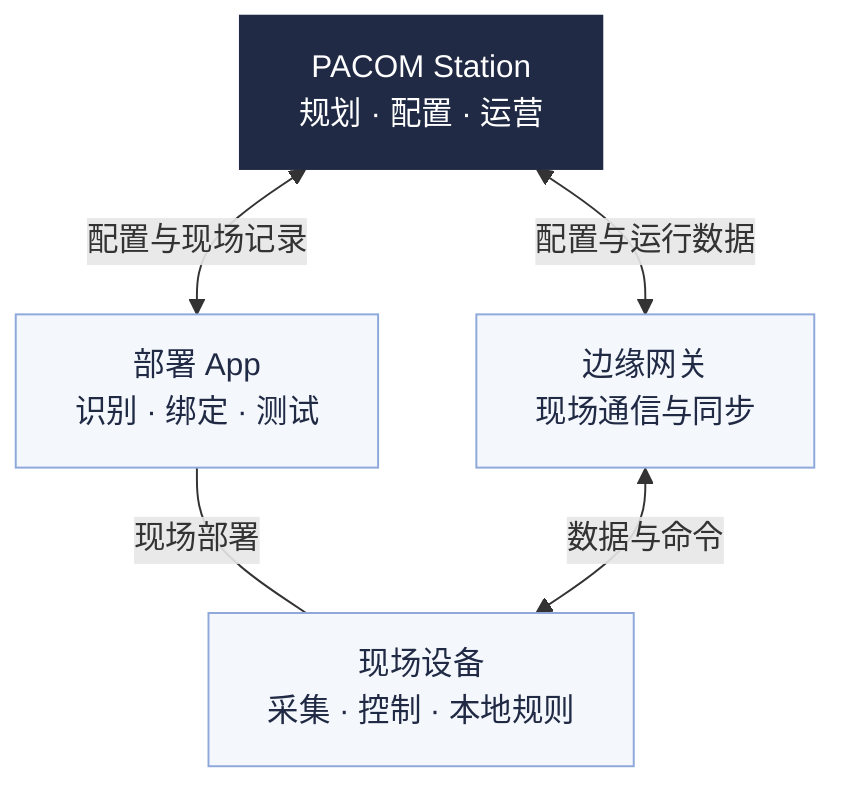

PACOM 智能建筑平台（PACOM Station）以项目、空间和设备为基础，组织照明、暖通空调、室内环境与能源管理。从规划到交付，再到日常运行，同一套空间与设备资料贯穿整个过程。

业主与运营人员关注建筑现在怎样运行、哪里需要处理；集成商关注设备如何配置、现场结果如何验证；机构管理员负责成员授权、配置批准与交付确认。

## 系统组成

Station 是云端管理平台，部署 App 是独立的现场工具。边缘网关衔接平台与现场设备网络，具体控制由网关、控制器或原厂系统按各自职责执行。

这是职责示意；实际接线、通信接口与网络结构请查阅对应设备资料。

| 组成 | 主要职责 |
| --- | --- |
| **PACOM Station** | 建立项目与空间、规划设备、登记应用配置；核对部署与交付记录，查看运行、告警和分析。 |
| **部署 App** | 将规划点位与实际设备对应，完成现场识别、绑定、配置与测试；同步现场记录和变更。 |
| **边缘网关** | 按设备与固件能力采集、同步和转发；承接已配置且经过验证的网关任务。 |
| **传感器、控制器与终端** | 传感器提供占用、照度或环境数据；控制器执行灯光、温控等动作；面板和开关提供现场操作。 |

**配置保存在平台，不等于现场已经生效。** 批准后还需核对设备应用回执、实际测试与交付记录。部署 App 不代替 Station 的项目管理，平台也不代替设备本地或原厂保护。

平台或网络暂不可用时，远程状态可能未知。本地自动控制、网关任务和跨系统动作的依赖不同；是否继续运行，应按设备、已下发配置和断联测试结果核对。

## 空间与设备如何组织

空间说明“在哪里、服务谁”，设备说明“由什么采集或执行”。例如，一个会议室功能区可以关联多功能传感器、照明控制器和空调设备；运营人员从会议室进入，配置人员再核对各设备与控制关系。

| 概念 | 如何理解 |
| --- | --- |
| **机构** | 成员、角色和项目的管理范围。操作前先确认当前机构。 |
| **空间层级** | 项目 → 楼宇 → 楼层 → 功能区。功能区是会议室、办公室等日常查看与控制的空间。 |
| **点位与设备** | 点位表达规划位置，设备表达现场实体；分别核对绑定或接入状态。画了点位不等于已安装。 |
| **设备网络** | 组织现场通信与部署。网络范围与空间层级分别管理。 |
| **照明回路与回路组** | 回路对应控制器及其负载；回路组组织共同控制。它们与用于管理的自定义分组用途不同。 |

空间调整在**项目**中完成；设备规划、网络和接入在**设备**中核对。下一步见[项目与设备](/platform/projects-devices)。

## 应用与典型场景

以下以办公建筑为例，说明各应用怎样帮助完成实际工作。使用前需确认所用版本已接入真实运行或执行服务；演示数据与模拟回执不能作为现场结果。

<AccordionGroup>
  <Accordion title="照明：办公区感应控制与临时调光" description="让自动策略与临时使用协调，核对灯光的实际状态。" defaultOpen>
    - **怎么用**：按功能区规划占用来源和照明回路，配置感应开关、延时及调光目标。临时调整亮度后，查看手动状态与恢复自动的安排。
    - **需要什么**：已绑定并验证的传感器、照明控制器及兼容负载。恒照度控制还需有效照度源与调光能力；开关型回路只能开关，不能按中间亮度调光。
    - **核对什么**：以控制器回报的开关、亮度和现场测试为准。同区感应开关与恒照度由控制器本地执行，无需另建联动。手动后的恢复按已应用规则验证。

    继续阅读[照明运行与控制](/platform/operations#照明)或[配置与交付](/platform/configuration-delivery)。
  </Accordion>

  <Accordion title="暖通空调：会议室温度与运行状态核查" description="区分室温、设定与实际运行，按设备能力调整。">
    - **怎么用**：从会议室查看室温、设定温度、模式与运行状态。需要调整时，在授权范围内操作，再核对回读；持续偏离时结合告警和现场情况排查。
    - **需要什么**：已接入的风机盘管温控器，或完成机型与接口验证的多联机空调网关。温度来源、可调范围和原厂限制须明确。
    - **核对什么**：室温不等于设备设定，已提交不等于已执行。风机盘管与多联机的策略分别配置；分体空调只有计量接入时，只分析用电。防冻、联锁等保护由设备本地或原厂系统承担。

    继续阅读[暖通空调](/platform/operations#暖通空调)。
  </Accordion>

  <Accordion title="室内环境：发现并核查会议室环境异常" description="先看指标、时间窗口和数据质量，再判断处理方式。">
    - **怎么用**：查看已接入的 CO₂、PM2.5、温湿度等指标及趋势，定位超出项目参考范围的空间，再核查占用、传感器位置与现场通风情况。
    - **需要什么**：有对应测量能力并完成验证的传感器，以及明确的参考范围、统计窗口和进入、解除条件。
    - **核对什么**：当前读数与统计均值用途不同；缺测不代表正常，占用表示“有人 / 无人”，不能当人数。平台参考提示不能替代正式环境检测结论。

    如需新风或净化联动，还须验证执行对象、接口与唯一控制主体；只有传感器不等于能够自动改善环境。继续阅读[室内环境](/platform/operations#室内环境)与[告警处理](/platform/alarms-maintenance)。
  </Accordion>

  <Accordion title="能源：查找非工作时段的异常用电" description="从总量和分项定位原因，用可比较的数据评估变化。">
    - **怎么用**：确认计量边界，查看总用电、分项与小时趋势；对照项目工作时间，查找持续用电的时段，再核对设备运行与现场负载。
    - **需要什么**：完成验证的表计或计量来源，正确的倍率、分项关系、时间范围与数据完整性。比较前后变化时，还需考虑天气、占用和运行时间的差异。
    - **核对什么**：计量值与按功率、亮度估算的值分别理解，缺失数据不记为零。碳排放计算须明确活动数据、因子与有效版本；不能仅凭一条曲线承诺节能率。

    继续阅读[能耗与碳排放](/platform/analysis-reports#能耗与碳排放)。
  </Accordion>
</AccordionGroup>

### 自动控制、场景、定时与联动

**自动控制**是设备按已配置规则运行；**场景**是一组动作；**定时**规定何时执行场景，**联动**规定满足什么条件时执行场景。

例如，可将授权范围内的灯光关断动作组织为“下班关灯”场景，再用定时引用它。核对项目时区、工作时间与节假日，确认目标、配置同步和逐对象执行结果。跨网络或跨系统动作还需核对各段连接与控制能力。[查看场景与执行记录](/platform/operations#场景与联动)。

## 开始使用

<Steps>
  <Step title="获得访问并确认机构">
    新机构由申请人提出，经 PACOM 审核开通；已有机构成员通过邀请加入。登录后确认机构名称，再核对自己的角色与授权范围。没有所需项目或功能区时，联系机构管理员。
  </Step>
  <Step title="确认项目处于哪个阶段">
    新项目先准备图纸、空间用途、设备与系统清单、工作时间和实施目标。已有项目先核对已交付网络、配置版本、运行数据来源与更新时间。
  </Step>
  <Step title="按职责进入工作">
    - **机构管理员**：在[机构与账户](/platform/organization-account)核对成员与授权，明确配置批准和交付责任。
    - **配置人员 / 集成商**：从[项目与设备](/platform/projects-devices)建立空间、规划设备，再按[配置与交付](/platform/configuration-delivery)完成部署、测试与交付。
    - **运营人员**：从[日常运营](/platform/operations)选择已交付范围，核对数据质量，再处理控制、场景与告警任务。
    - **查看人员**：查看授权项目的运行与分析资料，不执行控制或修改配置。
    - **普通成员**：从**我的区域**进入授权功能区，查看和控制自己的灯光、空调；不进入项目配置或场景管理。

    集成商不是独立的系统角色，实际操作范围由所在机构授予的角色与项目范围决定。需要接口对接时，另查[开发文档](/developers/index)。
  </Step>
</Steps>

## 如何判断已经准备好

沿以下状态逐项核对，不用一个“完成”代替所有结果。

| 状态 | 依据 |
| --- | --- |
| **已保存** | 平台中有当前规划或配置资料。 |
| **已批准** | 相关配置已获得批准；尚需核对现场应用。 |
| **已绑定 / 已接入** | 核对真实设备身份与相应回执；设备网络中的绑定与系统接入分别确认。 |
| **已应用** | 现场设备返回对应配置版本的成功应用回执。 |
| **在线** | 有有效通信记录，并核对最近更新时间。 |
| **已验证** | 功能、实际负载及必要的断联恢复测试通过，保留对应设备与配置版本的记录。 |
| **已交付** | 按完整网络范围核对版本与测试证据，完成交付确认并保留记录。 |

在线不等于功能已验证；部分房间通过测试不等于整个网络已交付。控制结果未知时先查询原请求和实际状态，避免重复下发。

完成入门后，建设项目进入[项目与设备](/platform/projects-devices)，现场实施进入[配置与交付](/platform/configuration-delivery)，已交付项目进入[日常运营](/platform/operations)。
