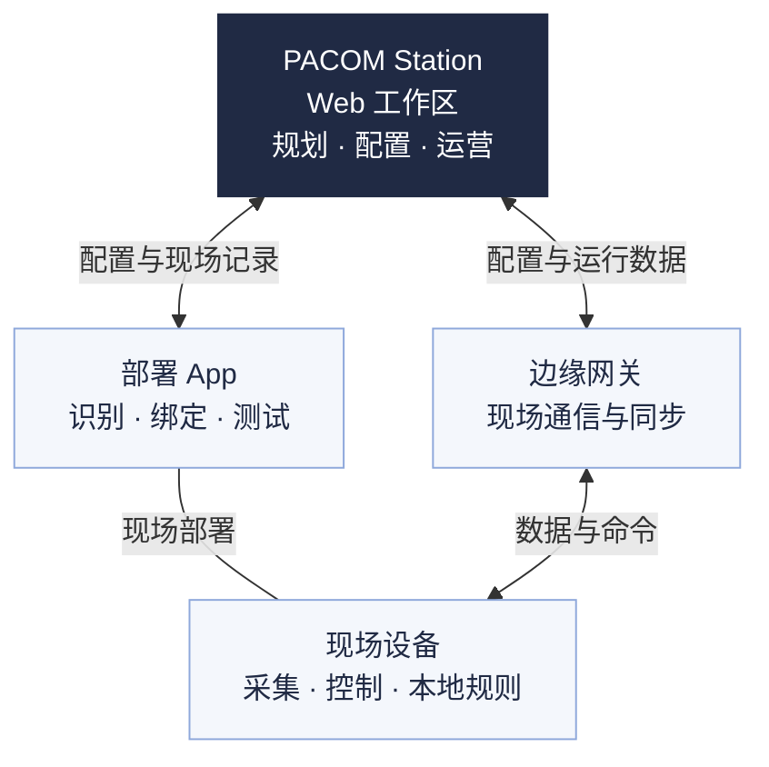

PACOM 智能建筑平台面向建筑业主、运营人员与集成商。通过 **PACOM Station** 工作区组织项目、空间和设备，管理照明、暖通空调、室内环境与能源，衔接现场部署、验证交付和日常运营。

<Note>
  当前正式版尚未接入账户、运行数据与执行等服务。规划资料和演示结果不能作为现场结果；具体功能以实际版本、服务与设备验证结果为准。
</Note>

## 系统组成

PACOM 智能建筑平台采用云端服务。**PACOM Station 是 Web 工作区**，用于规划、配置与运营；**部署 App 是独立现场工具**。边缘网关衔接云端服务与现场设备网络，具体控制由网关、控制器或原厂系统按各自职责执行。

这是职责示意；实际接线、通信接口与网络结构请查阅对应设备资料。

| 组成 | 主要职责 |
| --- | --- |
| **PACOM Station** | 建立项目与空间、规划设备、登记应用配置；核对部署与交付记录，查看运行、告警和分析。 |
| **部署 App** | 将规划点位与实际设备对应，完成现场识别、绑定、配置与测试；同步现场记录和变更。 |
| **边缘网关** | 按设备与固件能力采集、同步和转发；承接已配置且经过验证的网关任务。 |
| **传感器、控制器与终端** | 传感器提供占用、照度或环境数据；控制器执行灯光、温控等动作；面板和开关提供现场操作。 |

**配置保存在 Station，不等于现场已经生效。** 需要配置批准的参数由机构管理员批准后，仍须核对期望配置、设备应用回执与测试结果。部署 App 不代替 Station 的项目管理，平台也不代替设备本地或原厂保护。

平台或网络暂不可用时，远程状态可能未知。本地自动控制、网关任务和跨系统动作的依赖不同；是否继续运行，应按设备、已下发配置和断联测试结果核对。

首版采用 PACOM 云端服务。**已保存、已批准、已应用、已验证、已交付**分别判断，不能相互代替，见[使用条件](/platform/quickstart#使用条件)。

## 空间与设备概念

空间说明“在哪里、服务谁”，设备说明“由什么采集或执行”。例如，一个会议室功能区可以关联多功能传感器、照明控制器和空调设备；运营人员从会议室进入，配置人员再核对各设备与控制关系。

| 概念 | 如何理解 |
| --- | --- |
| **机构** | 成员、角色和项目的管理范围。操作前先确认当前机构。 |
| **空间层级** | 项目 → 楼宇 → 楼层 → 功能区。功能区是会议室、办公室等日常查看与控制的空间。 |
| **点位与设备** | 点位表达规划位置，设备表达现场实体；分别核对绑定或接入状态。画了点位不等于已安装。 |
| **设备网络** | 组织现场通信与部署。网络范围与空间层级分别管理。 |
| **照明回路与回路组** | 回路对应控制器及其负载；回路组组织共同控制。它们与用于管理的自定义分组用途不同。 |

空间调整在**项目**中完成；设备规划、网络和接入在**设备**中核对。分别查阅[项目管理](/platform/projects)与[设备管理](/platform/devices)。

## 四类应用

| 应用 | 关注的工作 |
| --- | --- |
| [照明控制](/platform/lighting) | 查看状态，协调感应、调光、手动控制与恢复自动。 |
| [暖通空调](/platform/hvac) | 区分室温、设定与运行状态，按设备能力调整。 |
| [室内环境](/platform/environment) | 查看已接入指标，核对参考范围、趋势与数据质量。 |
| [能源管理](/platform/energy) | 明确计量边界，分析用电、电费与碳排放。 |

## 典型场景

以下以办公建筑为例，说明各应用怎样帮助完成实际工作。使用条件见[快速入门](/platform/quickstart#使用条件)。

<AccordionGroup>
  <Accordion title="照明：办公区感应控制与临时调光" description="让自动策略与临时使用协调，核对灯光的实际状态。" defaultOpen={true}>

    - **怎么用**：按功能区规划占用来源和照明回路，配置感应开关、延时及调光目标。临时调整亮度后，查看手动状态与恢复自动的安排。
    - **需要什么**：已绑定并验证的传感器、照明控制器及兼容负载。恒照度控制还需有效照度源与调光能力；开关型回路只能开关，不能按中间亮度调光。
    - **核对什么**：以控制器回报的开关、亮度和现场测试为准。同区感应开关与恒照度由控制器本地执行，无需另建联动。手动后的恢复按已应用规则验证。

    继续阅读[照明运行与控制](/platform/lighting)或[部署调试](/platform/deployment)。

  </Accordion>
  <Accordion title="暖通空调：会议室温度与运行状态核查" description="区分室温、设定与实际运行，按设备能力调整。">

    - **怎么用**：从会议室查看室温、设定温度、模式与运行状态。需要调整时，在授权范围内操作，再核对回读；持续偏离时结合告警和现场情况排查。
    - **需要什么**：已接入的风机盘管温控器，或完成机型与接口验证的多联机空调网关。温度来源、可调范围和原厂限制须明确。
    - **核对什么**：室温不等于设备设定，已提交不等于已执行。风机盘管与多联机的策略分别配置；分体空调只有计量接入时，只分析用电。防冻、联锁等保护由设备本地或原厂系统承担。

    继续阅读[暖通空调](/platform/hvac)。

  </Accordion>
  <Accordion title="室内环境：发现并核查会议室环境异常" description="先看指标、时间窗口和数据质量，再判断处理方式。">

    - **怎么用**：查看已接入的 CO₂、PM2.5、温湿度等指标及趋势，定位超出项目参考范围的空间，再核查占用、传感器位置与现场通风情况。
    - **需要什么**：有对应测量能力并完成验证的传感器，以及明确的参考范围、统计窗口和进入、解除条件。
    - **核对什么**：当前读数与统计均值用途不同；缺测不代表正常，占用表示“有人 / 无人”，不能当人数。平台参考提示不能替代正式环境检测结论。

    如需新风或净化联动，还须验证执行对象、接口与唯一控制主体；只有传感器不等于能够自动改善环境。继续阅读[室内环境](/platform/environment)与[告警处理](/platform/alarms)。

  </Accordion>
  <Accordion title="能源：查找非工作时段的异常用电" description="从总量和分项定位原因，用可比较的数据评估变化。">

    - **怎么用**：确认计量边界，查看总用电、分项与小时趋势；对照项目工作时间，查找持续用电的时段，再核对设备运行与现场负载。
    - **需要什么**：完成验证的表计或计量来源，正确的倍率、分项关系、时间范围与数据完整性。比较前后变化时，还需考虑天气、占用和运行时间的差异。
    - **核对什么**：计量值与按功率、亮度估算的值分别理解，缺失数据不记为零。碳排放计算须明确活动数据、因子与有效版本；不能仅凭一条曲线承诺节能率。

    继续阅读[能耗与碳排放](/platform/energy)。

  </Accordion>
</AccordionGroup>

### 自动控制、场景、定时与联动

**自动控制**按已应用规则运行；**场景**是一组动作；**定时**按时间执行已有场景或恢复分组自动，**联动**按条件触发场景或相应控制动作。执行位置与断联条件按具体应用核对。

例如，可将授权范围内的灯光关断动作组织为“下班关灯”场景，再用定时引用它。核对项目时区、工作时间与节假日，确认目标、配置同步和逐对象执行结果。跨网络或跨系统动作还需核对各段连接与控制能力。[查看场景与执行记录](/platform/scenes)。

## 开始阅读

<Columns cols={3}>
  <Card title="快速入门" icon="compass" href="/platform/quickstart">
    获得访问，选择机构，按角色进入工作。
  </Card>
  <Card title="项目管理" icon="screwdriver-wrench" href="/platform/projects">
    建立项目、空间和设备，再配置、部署与交付。
  </Card>
  <Card title="运行总览" icon="sliders" href="/platform/runtime">
    查看状态、控制设备、处理异常并分析变化。
  </Card>
</Columns>

## 文档目录

| 分类 | 文档 |
| --- | --- |
| **开始使用** | [平台介绍](/platform/overview) · [快速入门](/platform/quickstart) |
| **配置** | [项目管理](/platform/projects) · [设备管理](/platform/devices) · [系统接入](/platform/integrations) · [应用配置](/platform/application-configuration) · [部署调试](/platform/deployment) |
| **运营** | [运行总览](/platform/runtime) · [照明控制](/platform/lighting) · [暖通空调](/platform/hvac) · [室内环境](/platform/environment) · [能源管理](/platform/energy) · [场景](/platform/scenes) · [告警](/platform/alarms) · [数据分析](/platform/analytics) |
| **设置** | [机构设置](/platform/organization) · [我的账户](/platform/account) |
| **帮助** | [智能助手](/platform/assistant) · [帮助与支持](/platform/support) |

设备型号、接线与安装要求查阅侧栏对应产品资料；接口与系统联调进入[开发文档](/developers/index)。
